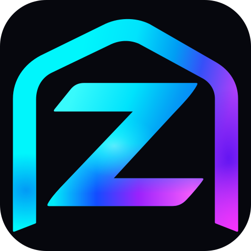

# ZeloteZ Rooms

Ein selbst gehosteter Treffpunkt für deinen Freundeskreis: schreiben, sprechen, den Bildschirm teilen und gemeinsam Videos schauen. Mitglieder kommen per Einladung dazu und nutzen Rooms im Browser oder mit der Desktop-App für Windows und Linux.

[English](README.md) · [简体中文](README.zh-CN.md) · **[Dokumentation](docs/de/README.md)** · [Downloads](https://github.com/ZeloteZ/ZeloteZ-Rooms/releases/latest)

## Das bietet Rooms

- Räume mit Text- und Livekanälen, Mitgliederzugriff und Moderation.
- Ende-zu-Ende-verschlüsselte Chatinhalte, Direktnachrichten und Chat-Anhänge.
- Sprachchat und Bildschirmfreigabe, in der Desktop-App mit Ausschnitt- und Audiooptionen.
- Synchronisierte Watchpartys mit YouTube oder lokalen Videodateien und gemeinsamer Warteschlange.
- Temporäre Räume mit optionalen Gastlinks und eine YouTube-Browsererweiterung.
- Oberfläche und Dokumentation auf Deutsch, Englisch und vereinfachtem Chinesisch.

Chatverschlüsselung, Medienübertragung und hochgeladene Videos haben unterschiedliche Datenschutzeigenschaften. Die Einzelheiten erklärt [Sicherheit und Datenschutz](docs/de/security.md).

## Hier geht es los

| Ich möchte … | Anleitung |
| --- | --- |
| Einer bestehenden Instanz beitreten | [Erste Schritte](docs/de/getting-started.md) |
| Die Funktionen kennenlernen | [Benutzerhandbuch](docs/de/user-guide.md) · [Streams und Watchpartys](docs/de/streaming.md) |
| Einen Client installieren | [Desktop-App](docs/de/desktop.md) · [YouTube-Erweiterung](docs/de/browser-extension.md) |
| Eine Instanz hosten | [Selbst hosten](docs/de/self-hosting.md) · [Konfiguration](docs/de/configuration.md) |
| Sie verwalten und warten | [Verwaltung](docs/de/administration.md) · [Betrieb](docs/de/operations.md) |
| Ein Problem lösen | [Fehlerbehebung](docs/de/troubleshooting.md) |

Die Dokumentation behandelt Einrichtung, Berechtigungen, Netzwerk, Backups, Wiederherstellung und bekannte Grenzen vollständig auf [Deutsch](docs/de/README.md), [English](docs/README.md) und [简体中文](docs/zh-CN/README.md). Für den Client brauchst du eine bestehende Instanz; ein Konto erstellst du über eine Einladung ihres Betreibers.

## Lizenz und Beiträge

Quellcode verfügbar unter [PolyForm Noncommercial 1.0.0](LICENSE). Kommerzielle Nutzungen außerhalb der Lizenzerlaubnisse benötigen eine gesonderte Genehmigung. Für Drittanbieter-Komponenten gelten deren eigene Lizenzen. Weitere Informationen stehen in den [Lizenzhinweisen](LICENSING.md).

Lies vor Beiträgen [CONTRIBUTING.md](CONTRIBUTING.md) und die [CLA](CLA.md).
