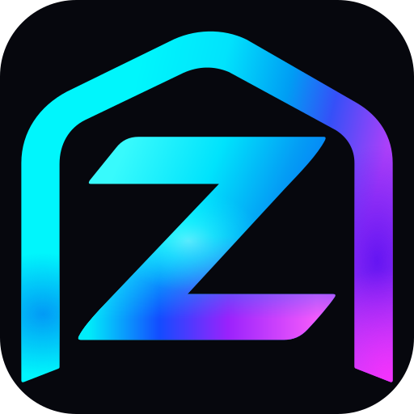

# ZeloteZ Rooms

为好友提供聊天、语音、屏幕分享和共同观影的邀请制空间。你可以自行托管实例，并通过浏览器或 Windows、Linux 桌面应用加入。

[English](README.md) · [Deutsch](README.de.md) · **[文档](docs/zh-CN/README.md)** · [下载](https://github.com/ZeloteZ/ZeloteZ-Rooms/releases/latest)

## Rooms 提供什么

- 带有文字和直播频道的房间、成员访问控制和管理功能。
- 端到端加密的聊天内容、私聊和聊天附件。
- 语音与屏幕分享，桌面应用还提供区域和音频选项。
- 同步观看 YouTube 或本地视频，并使用共享队列。
- 可选访客链接的临时房间，以及 YouTube 浏览器扩展。
- 完整的英语、德语和简体中文界面及文档。

聊天加密、媒体传输和上传视频具有不同的隐私属性。详情见[安全与隐私](docs/zh-CN/security.md)。

## 从这里开始

| 我想…… | 阅读 |
| --- | --- |
| 加入现有实例 | [入门](docs/zh-CN/getting-started.md) |
| 了解功能 | [用户指南](docs/zh-CN/user-guide.md) · [直播与观影派对](docs/zh-CN/streaming.md) |
| 安装客户端 | [桌面应用](docs/zh-CN/desktop.md) · [YouTube 扩展](docs/zh-CN/browser-extension.md) |
| 托管实例 | [自行托管](docs/zh-CN/self-hosting.md) · [配置](docs/zh-CN/configuration.md) |
| 管理和维护实例 | [管理](docs/zh-CN/administration.md) · [运行维护](docs/zh-CN/operations.md) |
| 解决问题 | [故障排查](docs/zh-CN/troubleshooting.md) |

## 许可证与贡献

源码采用 [PolyForm Noncommercial 1.0.0](LICENSE)。超出许可证允许范围的商业使用需要单独授权。第三方组件保留各自的许可证。详情见[许可说明](LICENSING.md)。

提交项目内容之前，请阅读 [CONTRIBUTING.md](CONTRIBUTING.md) 和 [CLA](CLA.md)。
